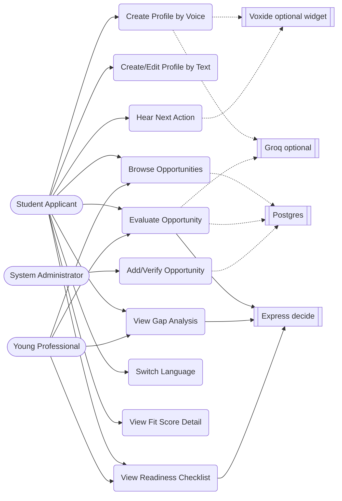
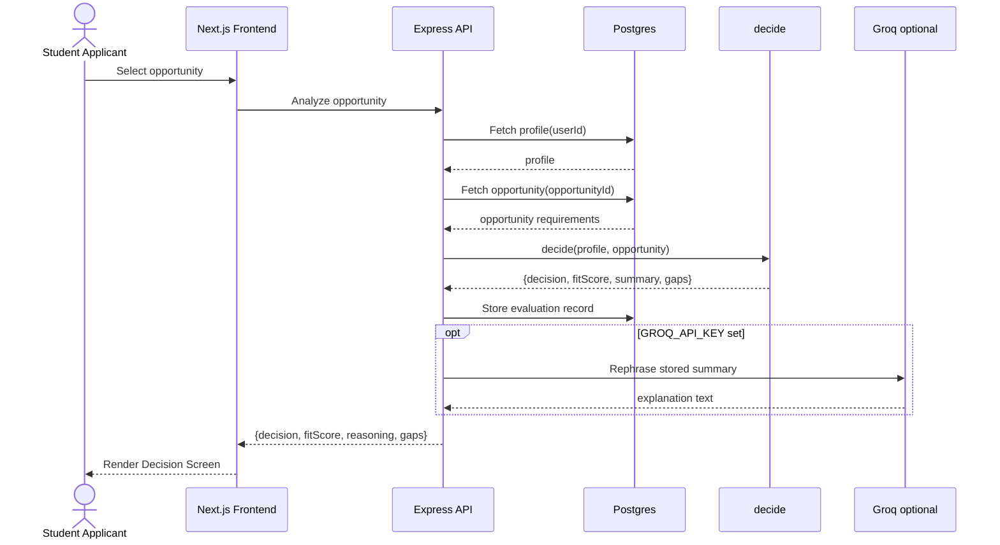
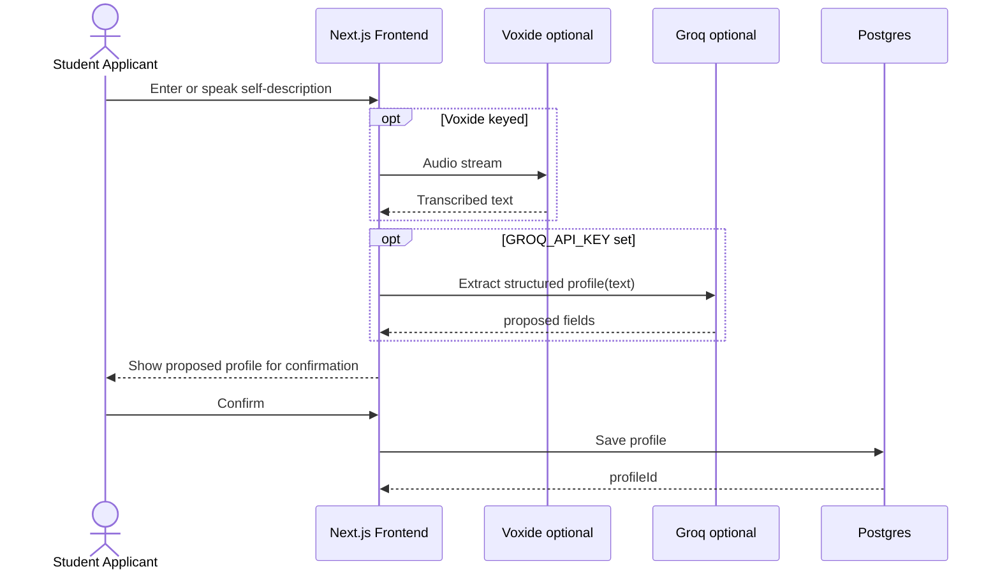
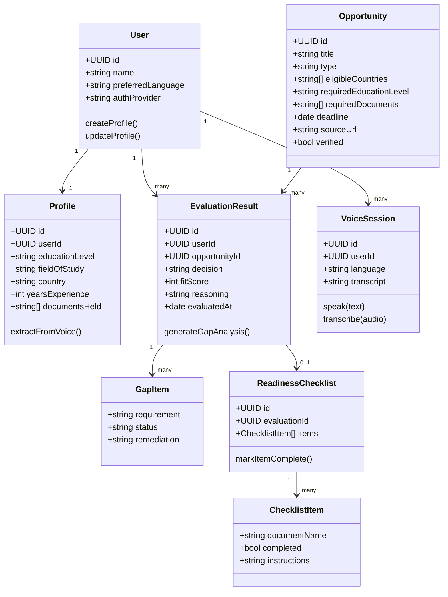
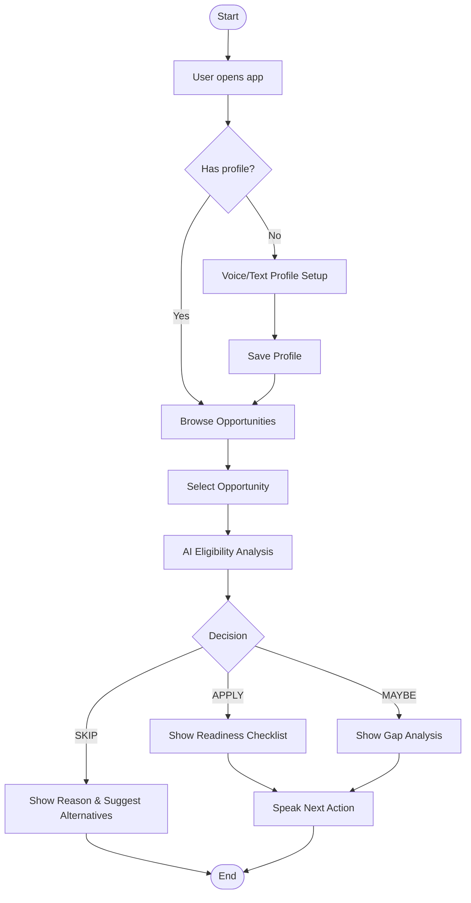
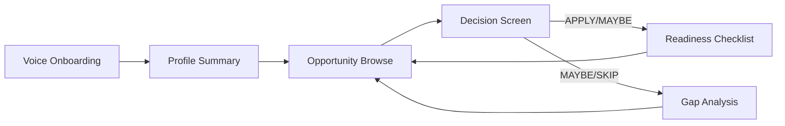
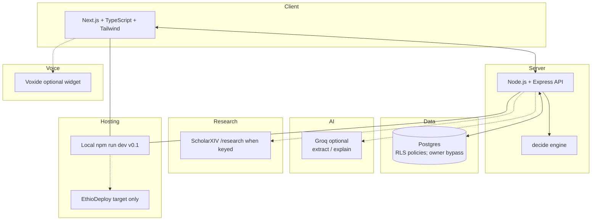
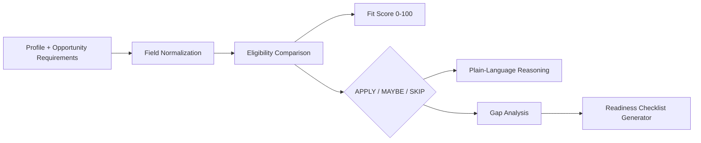
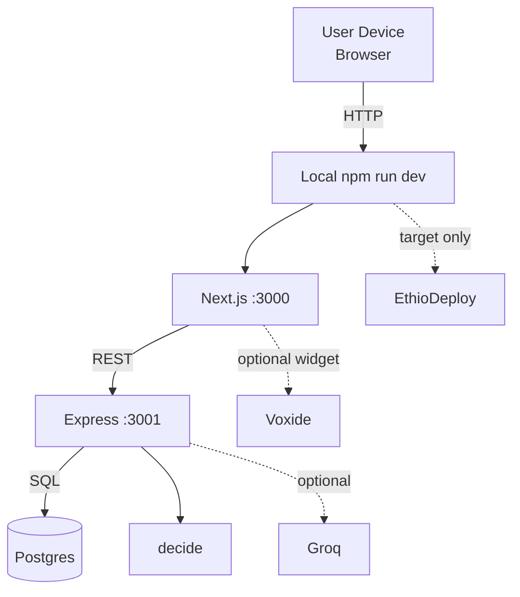
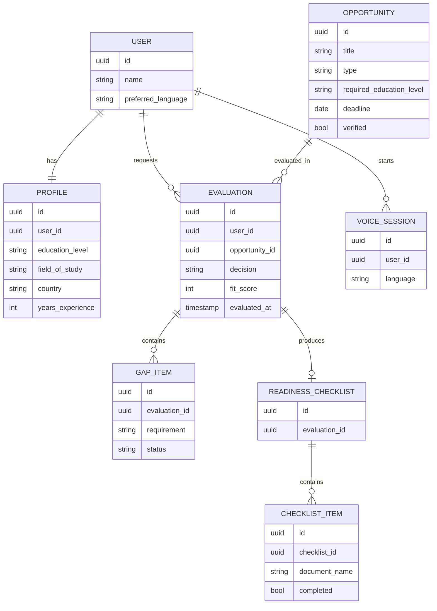

# HULUM
## AI Opportunity Decision & Readiness Agent

**Software Requirement Specification & System Design Document**

**Submitted by:** Team Ethiopian Builders
**Submitted for:** STARK Official Hackathon 2026
**Duration:** September 9 – October 2, 2026
**Location:** Addis Ababa, Ethiopia

> **Honesty (tip of `main`):** This SRS is background only. For what the product actually ships, trust `README.md`, `docs/stark/narrative.md`, and tip of `main` — not EthioDeploy-as-live, Claude-as-decider, invent OAuth/OTP/mail, or old HMAC/UI-preview auth paths.

---

## Abbreviations/Acronyms

| Abbreviation | Explanation |
|---|---|
| HULUM | "Opportunity" (Amharic) — name of the system |
| AI | Artificial Intelligence |
| SRS | Software Requirement Specification |
| UI/UX | User Interface / User Experience |
| API | Application Programming Interface |
| MCP | Model Context Protocol |
| RLS | Row-Level Security |
| DB | Database |
| STT | Speech-to-Text |
| TTS | Text-to-Speech |
| CRUD | Create, Read, Update, Delete |
| ERD | Entity Relationship Diagram |
| UID | User Identification |
| OOD | Object-Oriented Design |
| SDK | Software Development Kit |

---

## Table of Contents

1. **Chapter One — Project Proposal**
   1.1 Introduction
   1.2 Organizational Background
      1.2.1 Statement of the Problem
      1.2.2 Project General Objective
      1.2.3 Specific Objectives
      1.2.4 Feasibility of the Project
      1.2.5 Significance of the Project
      1.2.6 Beneficiaries of the Project
      1.2.7 Methodology
      1.2.8 Scope of the Project
      1.2.9 Limitations of the Project
      1.2.10 Project Deliverables and Phases
      1.2.11 Work Breakdown and Coordination
      1.2.12 Motivation
      1.2.13 Role Description of the Team
      1.2.14 Schedule
2. **Chapter Two — Requirement Analysis**
   2.1 Business Area Analysis
      2.1.1 Purpose of the System
      2.1.2 Document Conventions
      2.1.3 Intended Audience and Reading Suggestions
      2.1.4 Product Scope of the System
      2.1.5 User Classes and Characteristics
      2.1.6 Objectives and Success Criteria
      2.1.7 General Description
      2.1.8 Specific Description (Functional & Non-Functional Requirements)
   2.2 Current (Existing) System Description
   2.3 Players of the Existing System
   2.4 Proposed System
3. **Chapter Three — System Analysis and Design (Object-Oriented)**
   3.1 Introduction — Object-Oriented Concepts
   3.2 System Use Case
      3.2.1 List of System Use Cases
      3.2.2 UI Identification
      3.2.3 Actor Identification
      3.2.4 Use Case Diagram
      3.2.5 Use Case Description (Detailed/Textual)
   3.3 Sequence Diagramming
   3.4 Conceptual Modeling
      3.4.1 Refined Business Class Diagram
      3.4.2 Activity Diagramming
      3.4.3 User Interface Prototyping
4. **Chapter Four — System Design**
   4.1 Introduction
      4.1.1 Purpose of the System
      4.1.2 Design Goals
      4.1.3 Current Software Architecture
      4.1.4 Proposed Software Architecture
      4.1.5 Access Control and Security
      4.1.6 Global Software Control
      4.1.7 Boundary Conditions
5. **Chapter Five — Object Design**
   5.1 Introduction
   5.2 Object Design Trade-offs
   5.3 Interface Documentation Guidelines
   5.4 Packages
   5.5 Class Interfaces

---

# Chapter One — Project Proposal

## 1. Introduction

Access to information has never been Ethiopia's problem — access to *decision* has. Every day, hundreds of scholarships, fellowships, internships, jobs, grants, and competitions circulate across Telegram channels, Facebook groups, and scattered websites. Ethiopian students and young professionals are drowning in opportunities they cannot evaluate quickly enough. The result is a paradox of abundance: opportunities exist, but the confidence and clarity needed to act on them do not.

HULUM ("opportunity" in Amharic) is a voice-first AI opportunity decision and readiness agent designed to close this gap. Rather than adding another discovery feed to an already saturated information environment, HULUM evaluates opportunities against a user's personal profile and returns one decisive answer: **APPLY, MAYBE, or SKIP** — together with a fit score, a plain-language explanation, and an immediate next action.

This document formalizes HULUM's requirement analysis, system design, and object design in the same structured format used for formal software project documentation, adapted to the compressed timeline and scope of a 24-day hackathon build.

## 1.2 Organizational Background

HULUM is being built by **Team Ethiopian Builders** for the **STARK Official Hackathon 2026** (September 9 – October 2, 2026). The team operates as an independent hackathon unit rather than a registered company, with the explicit goal of producing a product that outlives the competition. The project is grounded in the observation that existing Ethiopian opportunity platforms (OpportunityHub, Ethio Scholarship, FutureFind) solve discovery but stop short of solving decision-making — the harder and more consequential problem.

### 1.2.1 Statement of the Problem

Ethiopian youth face an information environment that is broad but shallow. Specific problems include:

- **Decision paralysis from volume** — hundreds of opportunities appear daily; students cannot triage them fast enough to act before deadlines pass.
- **Wasted effort on ineligible opportunities** — hours are spent preparing applications for programs the applicant does not actually qualify for.
- **Missed opportunities from low confidence** — some students are eligible but skip applying because they are unsure, lack a second opinion, or cannot interpret formal eligibility language.
- **Language exclusion** — most international opportunity descriptions are in English, disadvantaging Amharic- and Afaan Oromo–speaking applicants who are otherwise qualified.
- **No structured readiness path** — even when a student decides to apply, there is no checklist translating "you are eligible" into "here is what you do first, second, third."
- **Unverified or stale postings** — some circulating opportunities are outdated, scams, or already closed, wasting user trust and time.

### 1.2.2 Project General Objective

The general objective of this project is to develop a voice-first AI agent that evaluates a user's eligibility and readiness for a given opportunity and returns a clear, actionable decision (APPLY / MAYBE / SKIP), reducing the time and confidence barrier between discovering an opportunity and acting on it.

### 1.2.3 Specific Objectives

- To design and build a voice-based profile intake flow supporting Amharic, English, and Afaan Oromo.
- To design an AI reasoning pipeline that compares a structured user profile against structured opportunity requirements.
- To implement the APPLY / MAYBE / SKIP decision mechanic with an accompanying 0–100 fit score and plain-language justification.
- To generate a gap analysis identifying precisely which requirements are unmet and how to close them.
- To generate a document-by-document readiness checklist with a spoken next action.
- To curate and verify a seed database of official-source opportunities.
- To integrate multilingual voice interaction (Voxide) for input and output.
- To incorporate research findings (via Scholarxiv) on eligibility communication and access barriers into product decisions.
- To deploy a working, publicly demonstrable product by the end of the hackathon (EthioDeploy, October 2, 2026).

### 1.2.4 Feasibility of the Project

#### 1.2.4.1 Economic Feasibility
The project uses cost-efficient, largely managed infrastructure: Supabase (free/low-tier Postgres + auth + RLS), the Claude API for reasoning, Voxide for voice, and EthioDeploy for hosting. No proprietary hardware is required. The primary cost is API usage (Claude reasoning calls and Voxide voice calls), which scales with usage and is manageable within a hackathon budget and, post-hackathon, a freemium model.

#### 1.2.4.2 Technical Feasibility
All required technologies (Next.js, TypeScript, Node.js/Express, Supabase/Postgres, Claude API, Voxide, MCP) are mature, documented, and within the team's stated skill set. The riskiest component is multilingual voice accuracy (especially Afaan Oromo), which is mitigated by scheduling voice integration as its own dedicated sprint phase (Days 11–14) with English as the fallback language.

#### 1.2.4.3 Operational Feasibility
The target users — Ethiopian students and young professionals — already use smartphones and consume opportunities via Telegram/Facebook, so a voice-and-chat web product fits existing behavior. No retraining of institutions or gatekeepers is required, since HULUM sits on the applicant side of the process, not the issuing side.

#### 1.2.4.4 Schedule Feasibility
The 24-day sprint is aggressive but is deliberately phased (Foundation → AI Engine → Voice → Polish → Demo Prep) so that a demonstrable core loop (profile → analysis → decision) exists well before voice or polish work begins, protecting the team against schedule slippage.

### 1.2.5 Significance of the Project

HULUM shifts the value proposition of opportunity platforms from *discovery* to *decision and readiness* — a distinction judges, users, and future partners can immediately grasp. For Ethiopian youth specifically, it lowers the two real barriers to applying: not knowing if you qualify, and not knowing what to do next. By supporting Amharic and Afaan Oromo voice interaction, it also extends access to opportunity evaluation to users who are excluded by English-only platforms.

### 1.2.6 Beneficiaries of the Project

- **Primary beneficiaries:** Ethiopian university students and recent graduates seeking scholarships, fellowships, internships, and remote jobs.
- **Secondary beneficiaries:** Young professionals pursuing grants, accelerators, and international career transitions.
- **Indirect beneficiaries:** Opportunity-issuing organizations (better-matched, better-prepared applicants), and the broader ecosystem of Ethiopian career-support platforms that HULUM can eventually integrate with or complement.

### 1.2.7 Methodology

The team follows an agile, sprint-based build methodology suited to a fixed hackathon deadline:

- **Daily commits** to a public GitHub repository, satisfying STARK's build-from-scratch requirement.
- **Milestone changelogs** published at each phase boundary.
- **Iterative core-loop-first development** — the AI decision loop is built and validated before voice, styling, or deployment polish.
- **Research-informed design** — Scholarxiv literature on eligibility communication and access barriers is consulted before finalizing how APPLY/MAYBE/SKIP explanations are worded.

### 1.2.8 Scope of the Project

In scope for the hackathon build:
- Voice and text profile intake in Amharic, English, and Afaan Oromo.
- AI-driven eligibility analysis against a curated, verified opportunity database.
- APPLY / MAYBE / SKIP decision output with fit score, gap analysis, and readiness checklist.
- A seed database of at least 10 verified opportunities at launch.
- Web deployment via EthioDeploy with a mobile-responsive UI.

**v0.1 note:** runtime catalog is investigator-filled (not ≥10 curated seed); EthioDeploy is the target host, not the current one (`docs/stark/deployment.md`).

Out of scope for the hackathon build (candidate for future phases):
- Direct application submission on behalf of the user.
- Payment processing or paid-tier features.
- Native mobile applications (iOS/Android).
- Automated crawling of unverified opportunity sources.

### 1.2.9 Limitations of the Project

- The opportunity database is manually curated and verified during the hackathon window, so coverage is limited to seeded entries rather than the full universe of circulating opportunities.
  **v0.1 note:** runtime catalog is investigator-filled Postgres; curated `db:seed` closed; list may be empty until the worker runs — not a shipped ≥10 curated seed set.
- Voice recognition accuracy for Afaan Oromo may lag behind Amharic and English given relatively less mature language-model and speech tooling.
- The system evaluates eligibility based on user-declared profile data; it does not independently verify credentials or documents.
- Time constraints limit the depth of automated opportunity-source verification to spot-checks against official domains rather than a full trust-scoring pipeline.

### 1.2.10 Project Deliverables and Phases

> **v0.1 (tip of `main`):** The third column is what judges can verify today. Original hackathon targets stay in *Description*; see `docs/stark/deployment.md`, `docs/stark/narrative.md`, `README.md`.

| Deliverable | Description (hackathon target) | v0.1 status (tip of `main`) |
|---|---|---|
| Working web application | Public demo on EthioDeploy | **Local only** — `npm run dev`; no EthioDeploy URL (`docs/stark/deployment.md`) |
| Source code repository | GitHub with daily commit history | **Shipped** — public repo + `CHANGELOG.md` |
| Seed opportunity database | ≥10 verified opportunities at launch | **Investigator-filled Postgres**; curated `db:seed` closed (`006`); list may be empty until worker runs |
| Voice interaction layer | Amharic, English, Afaan Oromo via Voxide | **English** text/quick actions + optional Voxide widget when keyed; **not** verified trilingual live mic/STT |
| Demo script and backup video | October 2 live presentation | **Script + backup doc** — `docs/demo/script.md`, `docs/demo/backup.md`; no hosted demo URL |
| STARK changelog entries | Recorded at every milestone | **Shipped** — root `CHANGELOG.md` + `docs/stark/*` |

### 1.2.11 Work Breakdown and Coordination

Work is broken down by system layer (Foundation/Data, AI Engine, Voice, Frontend/Polish, Deployment, Demo) and coordinated through the 24-day sprint calendar (see 1.2.14). Each phase produces an integration point so that later phases build on a tested core rather than parallel, unverified components.

### 1.2.12 Motivation

The team is motivated by a gap they have personally observed: Ethiopian peers who are demonstrably eligible for scholarships and jobs abroad, but who never apply — not for lack of ability, but for lack of a trusted second opinion telling them "yes, you qualify, and here is exactly what to do." HULUM is built to be that second opinion, and to remain useful long after the hackathon ends.

### 1.2.13 Role Description of the Team

| Role | Responsibility |
|---|---|
| Product/AI Lead | Owns the APPLY/MAYBE/SKIP reasoning design, prompt architecture, Claude API integration |
| Frontend Engineer | Next.js/TypeScript/Tailwind UI, mobile responsiveness, UI prototyping |
| Backend Engineer | Node.js/Express API layer, Supabase schema and RLS policies |
| Voice Integration Engineer | Voxide integration for Amharic, English, Afaan Oromo input/output |
| Research & Content Lead | Scholarxiv research questions, opportunity sourcing and verification, demo script |

### 1.2.14 Schedule

| Phase | Days | Focus | Deliverable |
|---|---|---|---|
| 1 | Days 1–3 | Foundation | Repo, schema, Supabase setup, 10 seed opportunities |
| 2 | Days 4–10 | AI Engine | APPLY/MAYBE/SKIP core loop, readiness checklist |
| 3 | Days 11–14 | Voice | Voxide integration — English, Amharic, Afaan Oromo |
| 4 | Days 15–20 | Polish | UI refinement, mobile responsiveness, production **configuration** in code (**host not deployed**) |
| 5 | Days 21–24 | Demo Prep | Demo script, rehearsal, backup video, final changelog |

---

# Chapter Two — Requirement Analysis

## 2.1 Business Area Analysis

### 2.1.1 Purpose of the System

HULUM exists to convert opportunity *discovery* into opportunity *decision*. Its purpose is to take a user's spoken or typed self-description, structure it into a profile, compare that profile against a specific opportunity's requirements using AI reasoning, and return a decisive, explainable recommendation together with a concrete path to readiness.

### 2.1.2 Document Conventions

This document follows a chapter-based SRS/design convention: Chapter One covers project proposal and planning; Chapter Two covers requirements; Chapter Three covers object-oriented analysis and design artifacts (use cases, sequence and activity diagrams, conceptual class model); Chapter Four covers system-level architecture and design; Chapter Five covers object-level design (class interfaces). Requirement identifiers use the prefix `FR-` (functional) and `NFR-` (non-functional). Diagrams are expressed in Mermaid syntax for portability within Markdown.

### 2.1.3 Intended Audience and Reading Suggestions

This document is intended for the HULUM hackathon team, STARK hackathon judges/evaluators, and any future contributor or investor evaluating the product's technical foundation. Readers primarily interested in *what* the product does should read Chapters One and Two; readers interested in *how* it is built should read Chapters Three through Five.

### 2.1.4 Product Scope of the System

HULUM is a web-based (mobile-responsive), voice-first application. Its scope covers: voice/text profile intake, AI-based eligibility and readiness evaluation, decision and gap-analysis output, and a curated opportunity database. It does not scope in application submission, payment processing, or opportunity-issuer-facing tools in this phase.

### 2.1.5 User Classes and Characteristics

| User Class | Characteristics |
|---|---|
| Student Applicant | Ethiopian university student, primary user, may prefer Amharic or Afaan Oromo voice input, seeking scholarships/internships |
| Young Professional | Recent graduate or early-career professional seeking grants, accelerators, or international roles |
| Guest/Unregistered User | Browses opportunities without a saved profile, limited to a single ad-hoc evaluation |
| System Administrator | Curates and verifies opportunities added to the database, manages content quality |

### 2.1.6 Objectives and Success Criteria

- **Objective:** Reduce decision time per opportunity. **Success criterion:** A user receives an APPLY/MAYBE/SKIP decision within seconds of selecting an opportunity, not hours of manual research.
- **Objective:** Increase applications among eligible users. **Success criterion:** Users presented with an APPLY decision and a readiness checklist proceed to prepare/apply at a higher rate than baseline self-assessment.
- **Objective:** Extend access via language. **Success criterion:** Non-English-first users can complete profile setup and receive decisions entirely by voice in Amharic or Afaan Oromo.
  **v0.1:** not met for live voice; English text/quick actions are the stable path; Amharic quick-action strings exist; Oromo UI/voice open (README, ADR 004).

### 2.1.7 General Description

HULUM operates as a three-part loop: **profile capture** (voice or text), **opportunity evaluation** (AI reasoning against structured criteria: education level, field of study, required documents, country eligibility, deadline, experience), and **decision delivery** (APPLY/MAYBE/SKIP, fit score, gap analysis, readiness checklist, and a spoken next action).

### 2.1.8 Specific Description (Functional & Non-Functional Requirements)

**Functional Requirements**

| ID | Requirement |
|---|---|
| FR-01 | The system shall allow a user to create a profile by voice in Amharic, English, or Afaan Oromo. |
| FR-02 | The system shall extract structured profile fields (education level, field of study, country, experience, documents held) from voice/text input using the Claude API. |
| FR-03 | The system shall allow a user to browse a curated list of opportunities from the Supabase database. |
| FR-04 | The system shall evaluate a selected opportunity against the user's profile and return a decision of APPLY, MAYBE, or SKIP. |
| FR-05 | The system shall compute and display a fit score between 0 and 100 for each evaluated opportunity. |
| FR-06 | The system shall generate a gap analysis listing unmet requirements and how to close them, when the decision is MAYBE or SKIP. |
| FR-07 | The system shall generate a document-by-document readiness checklist for opportunities marked APPLY or MAYBE. |
| FR-08 | The system shall speak the immediate next action aloud to the user via Voxide text-to-speech. |
| FR-09 | The system shall display verification/trust indicators for each opportunity, sourced from official channels. |
| FR-10 | The system shall allow an administrator to add, edit, and verify opportunity records. |
| FR-11 | The system shall allow returning users to update their profile without re-entering all information from scratch. |

**Non-Functional Requirements**

| ID | Requirement |
|---|---|
| NFR-01 (Performance) | The system shall return an eligibility decision within a few seconds of a user requesting evaluation. |
| NFR-02 (Usability) | **Target:** conversational speech in Amharic, English, and Afaan Oromo. **v0.1:** English text + quick actions; optional Voxide widget when keyed; **not** verified trilingual live mic/STT (`docs/demo/backup.md`, README). |
| NFR-03 (Security) | **Target:** owner-scoped RLS in Postgres. **v0.1:** policies in migrations `004`/`011`; API connects as table owner (owner bypasses RLS); JWT + route checks enforce ownership until a non-owner DB role (`database/README.md`). |
| NFR-04 (Reliability) | Opportunity records shall be verified against official sources before being surfaced to users, to avoid recommending expired or fraudulent postings. |
| NFR-05 (Availability) | **Target:** production reachable via EthioDeploy for evaluation. **v0.1:** local dev + CI smokes only — not deployed (`docs/stark/deployment.md`). |
| NFR-06 (Maintainability) | The AI evaluation logic shall be isolated from the profile and database layers so that reasoning prompts can be refined independently of the data model. |
| NFR-07 (Scalability) | The database schema shall support growth from an initial 10 seed opportunities to a much larger curated catalog without redesign. |
| NFR-08 (Localization) | **Target:** explanations in the user's chosen language (Amharic, English, or Afaan Oromo). **v0.1:** English UI/explain path; Amharic quick-action strings; Groq when keyed — not full trilingual explain. |

## 2.2 Current (Existing) System Description

Today, Ethiopian students discover opportunities through a fragmented mix of Telegram channels, Facebook groups, and dedicated discovery platforms such as **OpportunityHub**, **Ethio Scholarship**, and **FutureFind**. These platforms are effective at *aggregating* postings but stop at discovery: they list opportunities without evaluating an individual user's eligibility, without producing a fit score, and without generating a readiness plan. The burden of reading fine-print eligibility criteria, comparing it to one's own background, and deciding whether to invest hours in an application remains entirely on the user — manually, in a language (often English) that is not always their first.

## 2.3 Players of the Existing System

| Player | Role in Existing System |
|---|---|
| Opportunity Aggregator Platforms | Collect and list postings; no personalized evaluation |
| Telegram/Facebook Group Admins | Informally share postings; no verification guarantee |
| Student/Applicant | Manually reads, interprets, and decides on each posting |
| Issuing Organization | Publishes opportunity criteria; has no visibility into applicant fit before submission |

## 2.4 Proposed System

HULUM is proposed as a decision layer that sits on top of — and beyond — existing discovery platforms. Rather than replacing aggregation, it consumes a curated, verified set of opportunities and adds the missing evaluation step: a structured profile, an AI-reasoned comparison, and an explainable APPLY/MAYBE/SKIP outcome with a concrete readiness path, delivered in the user's language of choice, by voice.

---

# Chapter Three — System Analysis and Design (Object-Oriented)

## 3.1 Introduction — Object-Oriented Concepts

HULUM's analysis and design use standard object-oriented artifacts — use case diagrams, sequence diagrams, activity diagrams, and a conceptual class model — to move from user-facing requirements to implementation-ready structure. Core domain objects include `User`, `Profile`, `Opportunity`, `EvaluationResult`, `ReadinessChecklist`, and `VoiceSession`, each encapsulating its own data and behavior and interacting through well-defined interfaces (the Claude API for reasoning, Voxide for voice, Supabase for persistence).

## 3.2 System Use Case

### 3.2.1 List of System Use Cases

| ID | Use Case |
|---|---|
| UC-01 | Create Profile by Voice |
| UC-02 | Create/Edit Profile by Text |
| UC-03 | Browse Opportunities |
| UC-04 | Evaluate Opportunity (APPLY/MAYBE/SKIP) |
| UC-05 | View Gap Analysis |
| UC-06 | View Readiness Checklist |
| UC-07 | Hear Next Action (Voice Output) |
| UC-08 | Add/Verify Opportunity (Admin) |
| UC-09 | Switch Language |
| UC-10 | View Fit Score Detail |

### 3.2.2 UI Identification

| Screen | Purpose |
|---|---|
| Voice Onboarding Screen | Captures spoken profile description; shows live transcription |
| Profile Summary Screen | Displays structured profile extracted from voice/text; allows edits |
| Opportunity Browse Screen | Lists curated opportunities with trust indicators |
| Decision Screen | Displays APPLY/MAYBE/SKIP, fit score, and reasoning |
| Gap Analysis Screen | Lists unmet requirements and remediation guidance |
| Readiness Checklist Screen | Document-by-document action plan with progress tracking |
| Admin Opportunity Manager | CRUD interface for opportunity records and verification status |

### 3.2.3 Actor Identification

| Actor | Description |
|---|---|
| Student Applicant | Primary actor; creates a profile and evaluates opportunities |
| Young Professional | Secondary actor; same interactions as Student Applicant with different opportunity focus |
| System Administrator | Curates and verifies opportunity records |
| Express `decide()` (engine) | Supporting actor; owns APPLY / MAYBE / SKIP and requirement matching |
| Groq (optional) | Supporting actor; extract/explain when `GROQ_API_KEY` is set — never sets the decision |
| Voxide (Voice Service) | Supporting actor; optional browser widget when keyed — not verified trilingual live mic |
| Postgres (Data Store) | Supporting actor; persists profiles, opportunities, and evaluation history (Supabase-hosted Postgres OK) |

### 3.2.4 Use Case Diagram



### 3.2.5 Use Case Description (Detailed/Textual)

**UC-04: Evaluate Opportunity (APPLY/MAYBE/SKIP)**

| Field | Description |
|---|---|
| Use Case ID | UC-04 |
| Actors | Student Applicant, Young Professional, Express API / `decide()`, Postgres; Groq optional |
| Precondition | User has a saved profile and has selected an opportunity |
| Main Flow | 1. User selects an opportunity from the browse screen. 2. System retrieves the opportunity's structured requirements from Postgres. 3. Backend runs **`decide(profile, opportunity)`** (deterministic). 4. System stores the analysis and displays APPLY/MAYBE/SKIP, fit score, and engine summary. 5. Optional: Groq rephrases the stored summary when keyed (decision unchanged). |
| Alternate Flow | If profile data is insufficient for a confident decision, the system requests the missing field(s) from the user before finalizing the evaluation. |
| Postcondition | An evaluation record is created and linked to the user and opportunity. |

**UC-01: Create Profile by Voice**

| Field | Description |
|---|---|
| Use Case ID | UC-01 |
| Actors | Student Applicant; Voxide optional; Groq optional; Postgres |
| Precondition | User has opened profile setup (text or optional voice widget when keyed) |
| Main Flow | 1. User enters or speaks a self-description. 2. Optional Voxide converts speech to text when keyed. 3. Optional Groq extracts structured profile fields when keyed. 4. System displays the proposed fields for confirmation. 5. User confirms or edits; profile is saved to Postgres. |
| Alternate Flow | If transcription confidence is low, the system asks the user to repeat or switch to text input. |
| Postcondition | A structured `Profile` record exists for the user. |

**UC-06: View Readiness Checklist**

| Field | Description |
|---|---|
| Use Case ID | UC-06 |
| Actors | Student Applicant, Express API / engine; Groq optional; Voxide optional |
| Precondition | An opportunity has been evaluated as APPLY or MAYBE |
| Main Flow | 1. User opens the readiness checklist for the evaluated opportunity. 2. System builds checklist items from engine gap analysis (optional Groq wording when keyed). 3. System displays the checklist with checkable items. 4. Optional: Voxide widget may speak a next action when keyed — not claimed as default demo path. |
| Postcondition | The checklist is saved and its completion state persists across sessions. |

## 3.3 Sequence Diagramming

**Sequence: Evaluate Opportunity (UC-04)**



**Sequence: Create Profile by Voice (UC-01)**



## 3.4 Conceptual Modeling

### 3.4.1 Refined Business Class Diagram



### 3.4.2 Activity Diagramming

**Activity: End-to-End Decision Flow**



### 3.4.3 User Interface Prototyping — Navigational Paths and Screen Mock-Ups

**Navigational Flow:**



**Screen-level notes:**
- *Voice Onboarding Screen:* Large microphone control, live waveform, language selector (Amharic / English / Afaan Oromo) shown before recording starts.
- *Opportunity Browse Screen:* Card list with trust badge (verified source icon), deadline countdown, and opportunity type tag.
- *Decision Screen:* Large color-coded badge (APPLY = green, MAYBE = amber, SKIP = red), fit score as a radial progress indicator, plain-language reasoning below the fold.
- *Readiness Checklist Screen:* Checkable list grouped by document type, with a persistent "next action" banner that can be replayed by voice.

---

# Chapter Four — System Design

## 4.1 Introduction

### 4.1.1 Purpose of the System

Chapter Four translates the requirements and conceptual model from Chapters Two and Three into a concrete software architecture: how HULUM's frontend, backend, database, AI engine, and voice layer are decomposed, deployed, and secured.

### 4.1.2 Design Goals

#### 4.1.2.1 Performance Requirement
Eligibility evaluations should return within a few seconds so the interaction feels conversational rather than transactional, which is essential given the voice-first interface.

#### 4.1.2.2 Safety Requirement
The system must never present a fabricated or unverifiable decision as fact; every APPLY/MAYBE/SKIP decision must be traceable to specific, stated eligibility criteria from a verified opportunity record.

#### 4.1.2.3 Security Requirement
User profile data (education, documents held, personal background) is sensitive and must be protected using Supabase Row-Level Security so users can only access their own records.

#### 4.1.2.4 Software Quality Attribute
Correctness of the decision engine is the top-priority quality attribute, followed by usability of the voice interface across three languages, followed by maintainability of the reasoning prompts.

#### 4.1.2.5 Dependability
The system should degrade gracefully — if Voxide voice services are unavailable, the system falls back to text input/output rather than failing entirely.

#### 4.1.2.6 Maintenance
The AI reasoning logic is isolated behind a service layer so that prompt or model changes (e.g., upgrading the Claude model version) do not require changes to frontend or database code.

#### 4.1.2.7 End User
The end user is assumed to be a mobile-first, data-conscious Ethiopian student or young professional, motivated but time-constrained, who may be more comfortable speaking than typing, especially in Amharic or Afaan Oromo.

### 4.1.3 Current Software Architecture

There is no prior HULUM system; the "current" state for the target user is a manual, cross-platform search-and-judge process across Telegram, Facebook, and discovery websites with no software architecture of its own.

### 4.1.4 Proposed Software Architecture

#### 4.1.4.1 Overview

HULUM follows a layered client-server architecture: a Next.js/TypeScript frontend, a Node.js/Express backend API, PostgreSQL persistence (often Supabase-hosted) with RLS policies present but API still connecting as table owner, a **deterministic `decide()` engine**, optional **Groq** for extract/explain when keyed, optional Voxide browser widget when keyed, and a research layer via ScholarXIV (`/research` when keyed) that does not set APPLY/MAYBE/SKIP. **v0.1 host:** local `npm run dev` — EthioDeploy is target only (`docs/stark/deployment.md`).

#### 4.1.4.2 Software Architecture



#### 4.1.4.3 System Decomposition

| Subsystem | Responsibility |
|---|---|
| Frontend Subsystem | Voice/text capture, screen rendering, navigation, playback of spoken responses |
| Backend/API Subsystem | Request orchestration, business logic, profile/opportunity CRUD, calling AI and voice services |
| AI Reasoning Subsystem | Deterministic matching/`decide()`; optional Groq extract/explain when keyed |
| Voice Subsystem | Optional Voxide widget when keyed; English text/quick actions are the stable path |
| Data Subsystem | Persistent storage of users, profiles, opportunities, evaluations, checklists |
| Research Subsystem | Supplies research findings that shape prompt design and UX copy (offline/design-time use) |

#### 4.1.4.4 Subsystem Decomposition

**AI Reasoning Subsystem (detail):**



#### 4.1.4.5 Hardware/Software Mapping

| Component | Environment |
|---|---|
| Frontend | Next.js on local `:3000` (EthioDeploy = target) |
| Backend API | Express on local `:3001` (EthioDeploy = target) |
| Database | Postgres via `DATABASE_URL` (often Supabase-hosted) |
| Decision engine | In-process `decide()` in Express |
| Explanation / extract | External Groq over HTTPS when keyed |
| Voice Service | Optional `@voxide/react` widget when keyed |
| Client Devices | Mobile and desktop browsers (Ethiopian users, primarily mobile) |

#### 4.1.4.6 Deployment Modeling



#### 4.1.4.7 Persistent Data Management

**Entity Relationship Diagram**



### 4.1.5 Access Control and Security

- Authentication is handled via Supabase Auth; each request to the backend carries a verified session token.
- Row-Level Security policies restrict `Profile`, `EvaluationResult`, and `ReadinessChecklist` rows to their owning `user_id`.
- Administrator actions on `Opportunity` records require an elevated role claim, checked both in Supabase RLS policy and in the Express API middleware.
- All external calls (Claude API, Voxide) are made server-side from the backend, so API keys are never exposed to the client.

### 4.1.6 Global Software Control

The backend API acts as the single control point coordinating calls to the database, AI engine, and voice service; the frontend never calls the Claude API or Voxide directly for anything that touches persisted user data, keeping control logic centralized and auditable.

### 4.1.7 Boundary Conditions

#### 4.1.7.1 Initialization Procedure
On first load, the frontend checks for an existing authenticated session; if none exists, the user is routed to the voice/text onboarding flow before any opportunity browsing is permitted.

#### 4.1.7.2 Shut Down Procedure
There is no persistent client-side state beyond the current session token; closing the app has no destructive effect, and in-progress checklist completion state is persisted server-side after each toggle.

#### 4.1.7.3 Exception Handling
- If the Claude API call fails or times out, the backend returns a graceful "evaluation temporarily unavailable, please retry" response rather than a blank decision.
- If Voxide transcription confidence is below threshold, the frontend prompts the user to repeat or switch to text input rather than silently guessing.
- If an opportunity's deadline has passed at evaluation time, the system automatically returns SKIP with the reason "deadline passed" without invoking full AI comparison.

---

# Chapter Five — Object Design

## 5.1 Introduction

Chapter Five specifies the object-level interfaces implementing the classes introduced in the conceptual model (3.4.1), refined for implementation in TypeScript across the Next.js frontend and Express backend.

## 5.2 Object Design Trade-offs

### 5.2.1 Development Cost versus Functionality
Given the 24-day timeline, the team prioritizes a single, well-tuned AI reasoning pipeline (profile-vs-opportunity comparison) over building a broader set of shallow features; voice language coverage is sequenced (English/Amharic first, Afaan Oromo second) rather than attempted simultaneously.

### 5.2.2 Understandability versus Cost
Decision explanations are deliberately kept in plain language rather than exposing raw model confidence scores or internal reasoning chains, trading some transparency detail for user comprehension — directly informed by the Scholarxiv research question on communicating eligibility uncertainty responsibly.

### 5.2.3 Security versus Cost
Row-Level Security is applied at the database layer rather than relying solely on application-layer checks, at some added schema complexity, to ensure profile data remains protected even if a backend authorization check is missed.

## 5.3 Interface Documentation Guidelines

All backend endpoints are documented as REST resources under `/api/v1/`, returning JSON with a consistent `{ data, error }` envelope. AI service calls are wrapped in an internal `AIReasoningService` interface so the underlying model/version can change without altering calling code.

## 5.4 Packages

| Package | Contents |
|---|---|
| `frontend/` | Next.js pages/components, Tailwind styles, voice UI components |
| `backend/routes/` | Express route handlers (profile, opportunities, evaluations, checklist, admin) |
| `backend/services/` | `AIReasoningService`, `VoiceService`, `OpportunityService` |
| `backend/db/` | Supabase client, schema migrations, RLS policies |
| `shared/types/` | TypeScript interfaces shared between frontend and backend |

## 5.5 Class Interfaces

### 5.5.1 User Class
```typescript
interface User {
  id: string;
  name: string;
  preferredLanguage: "am" | "en" | "om";
  authProvider: string;
  createProfile(data: ProfileInput): Promise<Profile>;
  updateProfile(id: string, data: Partial<ProfileInput>): Promise<Profile>;
}
```

### 5.5.2 Profile Class
```typescript
interface Profile {
  id: string;
  userId: string;
  educationLevel: string;
  fieldOfStudy: string;
  country: string;
  yearsExperience: number;
  documentsHeld: string[];
  extractFromVoice(transcript: string): Promise<Profile>;
}
```

### 5.5.3 Opportunity Class
```typescript
interface Opportunity {
  id: string;
  title: string;
  type: "scholarship" | "fellowship" | "internship" | "job" | "grant" | "competition";
  eligibleCountries: string[];
  requiredEducationLevel: string;
  requiredDocuments: string[];
  deadline: string; // ISO date
  sourceUrl: string;
  verified: boolean;
}
```

### 5.5.4 EvaluationResult Class
```typescript
interface EvaluationResult {
  id: string;
  userId: string;
  opportunityId: string;
  decision: "APPLY" | "MAYBE" | "SKIP";
  fitScore: number; // 0-100
  reasoning: string;
  evaluatedAt: string;
  generateGapAnalysis(): Promise<GapItem[]>;
}
```

### 5.5.5 GapItem Class
```typescript
interface GapItem {
  requirement: string;
  status: "met" | "unmet" | "unverified";
  remediation: string;
}
```

### 5.5.6 ReadinessChecklist Class
```typescript
interface ReadinessChecklist {
  id: string;
  evaluationId: string;
  items: ChecklistItem[];
  markItemComplete(itemId: string): Promise<void>;
}
```

### 5.5.7 ChecklistItem Class
```typescript
interface ChecklistItem {
  documentName: string;
  completed: boolean;
  instructions: string;
}
```

### 5.5.8 VoiceSession Class
```typescript
interface VoiceSession {
  id: string;
  userId: string;
  language: "am" | "en" | "om";
  transcript: string;
  speak(text: string): Promise<void>;
  transcribe(audio: Blob): Promise<string>;
}
```

### 5.5.9 AIReasoningService (Backend Service Interface)
```typescript
interface AIReasoningService {
  extractProfile(transcript: string, language: string): Promise<ProfileInput>;
  evaluate(profile: Profile, opportunity: Opportunity): Promise<EvaluationResult>;
  buildChecklist(evaluation: EvaluationResult): Promise<ChecklistItem[]>;
}
```

---

## Closing Statement

HULUM does not just find opportunities — it tells a user which ones are worth their time, and exactly what to do next. This document formalizes that promise into a requirement, design, and object model intended to guide a 24-day build from Day 1 foundation work to a reproducible local demo (`README.md`, `docs/demo/script.md`). EthioDeploy / public host remains open (`docs/stark/deployment.md`).
